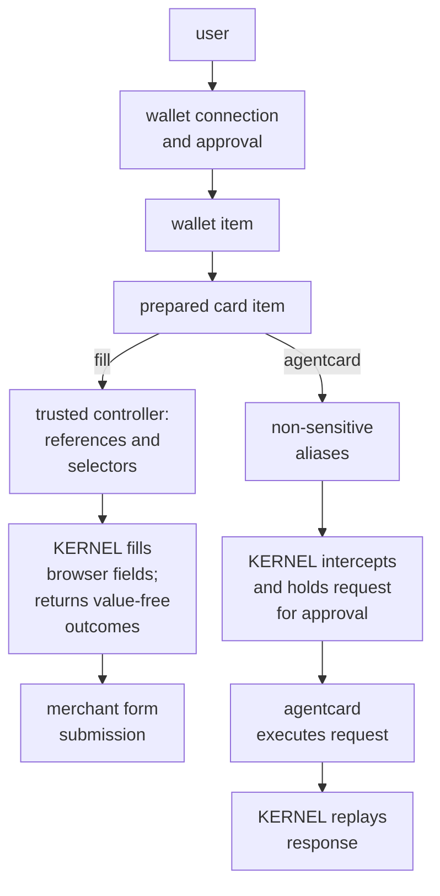

your browser agent can complete purchases with KERNEL while your application keeps control of the purchase and user approval. native [wallet integrations](/integrations/wallets/overview) connect the user's payment method to a [vault](/vaults/overview), so your agent works with payment items rather than raw card details.

KERNEL's [`fill` api](/vaults/fill) safely injects stored values into browser fields without passing them through your application's injection code or the model's context. you provide an item reference, browser, and field selectors; KERNEL writes the values and returns per-field outcomes, not the values. wallet integrations supply payment material and approval; `fill` is a KERNEL operation shared with non-payment vault items.

agentcard uses an integration-specific alternative: the agent enters non-sensitive aliases, and KERNEL holds a recognized checkout request for approval before agentcard executes it and KERNEL replays the response. the underlying card stays outside the browser.

## Why use KERNEL payments

- **keep raw values out of the application and model handoff.** use KERNEL's `fill` api to inject stored payment values instead of retrieving them and passing them through application code or agent prompts.
- **connect wallets through native integrations.** use vault items, advertised operations, and hosted actions for connection and purchase approval. KERNEL handles the provider interaction, including link card issuance or agentcard's approved request execution and response replay.
- **control the purchase.** verify purchase details in your application and present provider-hosted approval to the user outside the agent. vault attachments and item lifecycle checks control which browser can use the payment item.
- **observe the attempt.** inspect value-free operation outcomes and item events, then reconcile with the merchant's order record. a completed fill or approval is not proof of payment.

## How payments work

1. create a vault for the user or task.
2. create a wallet item and send the user through the provider-hosted collection flow.
3. attach the vault when you create the browser session. the attachment also covers items created later in that vault.
4. create a card item for the verified, user-confirmed purchase. complete the provider's required preparation and approval. KERNEL card authorizes before checkout and, for eligible cards, fills a network token with a one-time security code; link authorizes at the checkout page and issues a merchant-bound link pay token on supported stripe checkouts or a single-use virtual card elsewhere; agentcard can reuse a card item with separate approval for each checkout.
5. invoke KERNEL's advertised `fill` operation to inject payment fields without supplying their values, then inspect the outcomes before submitting. for agentcard's alias-based flow, enter aliases and keep a trusted approval observer running while the checkout request is held.
6. submit checkout once, complete any remaining provider-hosted approval, and reconcile with the merchant's order state. fill or approval alone is not payment success.

`wallet` and `card` are vault item types. the wallet supplies the provider connection; the card represents payment material and its authorization state. where enabled for your organization, link and KERNEL purchases can also be `payment_request` items, which work like card items; agentcard purchases are always `card` items. retrieve the item and check `available_operations` before invoking an operation. don't assume every item supports `fill`.

## Verify the purchase

your application must independently verify the merchant, items, amount, and currency before creating or authorizing a purchase. keep wallet collection and approval urls in trusted user-facing surfaces, not model context. after submission, use the merchant's order record to establish whether the expected purchase succeeded.

<Warning>
  don't retry a failed, timed-out, rejected, or indeterminate payment. a browser error, missing response, completed `fill`, or reusable card item does not prove whether the merchant created an order or money moved. inspect existing outcomes, item events, and merchant state before taking another action.
</Warning>

## Get started

- [choose a wallet integration](/integrations/wallets/overview) for payment-method connection, approval, and reuse options.
- [KERNEL card](/integrations/wallets/kernel) to collect a user's card directly, with hosted or embedded enrollment.
- [KERNEL payment methods](/integrations/wallets/kernel-payment-methods) to hold several cards in one KERNEL wallet and choose which card pays.
- [enable payments in a browser agent](/browsers/enable-payments-in-browser-agent) for the controller, agent, and checkout walkthrough.
- [fill browser fields](/vaults/fill) for KERNEL's injection api, field selection, and outcome contract.
- [pricing](/info/pricing) for vault limits and payment charges.
