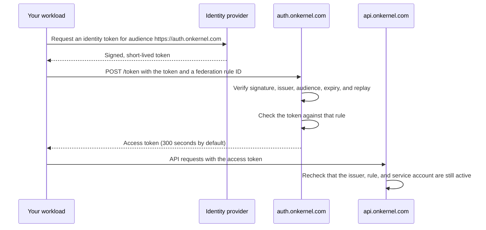

Workload identity federation lets a workload authenticate to KERNEL without an API key. The workload presents a short-lived OpenID Connect (OIDC) token from an identity provider it already has: GitHub Actions, AWS, Google Cloud, Microsoft Entra, Kubernetes, or any OIDC issuer. KERNEL checks the token against rules you configure and returns a KERNEL access token that expires in five minutes.

Use it for every workload that isn't a person at a keyboard. A few operations, such as running app deployments, [stay closed to service accounts](/info/workload-identity/service-accounts#what-a-service-account-cant-do), so check them before you plan a migration. A stored API key works until someone revokes it, so one leaked CI variable is standing access to your browsers, profiles, and credentials. With federation:

- **There's no secret to leak.** Nothing is stored in CI variables, config files, or secret managers. The federation rule ID your workload sends is an identifier, not a credential.
- **Tokens expire in minutes.** An access token lasts 300 seconds by default and 600 at most. The SDKs exchange a fresh one before it expires.
- **Access is tied to one workload.** A rule names exactly who can authenticate, such as one repository, workflow, and branch, or one IAM role. A token from anywhere else is refused.
- **Access is narrow by construction.** Every rule is limited to one project and an explicit list of permissions.

<Note>
Federation is as strong as the identity provider that signs the tokens. Write rules as specific as your workload allows, and keep using the controls your provider gives you, such as protected branches and deployment environments.
</Note>

API keys still have a place for local development and for environments with no identity provider. See [API authentication](/info/authentication) for how to choose.

## Concepts

An organization admin sets up three resources. Together they say: tokens signed by this **issuer**, that match this **rule**, can act as this **service account**.

### Service accounts

A **service account** (`svc_...`) is a named, non-human identity that your organization owns. It's what a workload acts as: browsers the workload creates are recorded as created by the service account, and it shows when it was last used.

A service account has only a name and a description. It has no permissions of its own. Each federation rule that targets it sets the project and permissions for the tokens that rule issues. See [Service accounts](/info/workload-identity/service-accounts).

### Issuers

An **issuer** (`wii_...`) registers an identity provider with your organization. It tells KERNEL which `iss` claim to expect and where to get the provider's public signing keys.

Each issuer has a provider type: `github_actions`, `aws`, `google_cloud`, `microsoft_entra`, `kubernetes`, or `custom_oidc`. The type decides which identity checks a rule on that issuer must make. Registering an issuer accepts no token by itself. Only a rule does that.

### Federation rules

A **federation rule** (`wifr_...`) decides which tokens from an issuer are accepted and what they can do. A rule has:

- **Match conditions.** What the token must say about the workload. Each provider type has its own required conditions. A GitHub Actions rule, for example, names a repository by its numeric ID, a workflow, and a branch or environment.
- **Expected audience.** The `aud` claim the token must carry. The SDKs request `https://auth.onkernel.com`.
- **Target.** The service account the workload acts as.
- **Authorization.** One project, a permission policy inside that project, and the access token lifetime.

A rule covers exactly one project. To give a workload access to two projects, such as staging and production, create two rules. An issuer can have as many rules as you need.

Issuers and rules are created disabled. Nothing is trusted until you enable the issuer and then the rule.

## How it works



1. **Your identity provider issues a token to the workload.** Most platforms hand it over without any setup in your code: the GitHub Actions runner, the AWS Security Token Service, the Google Cloud metadata server, or a file Kubernetes mounts into the pod.
2. **The SDK exchanges it for a KERNEL access token.** It sends the token and your federation rule ID to `POST https://auth.onkernel.com/token`. The request needs no KERNEL credential. The rule ID only selects which rule to check; the token must still satisfy it.
3. **The SDK calls the API with the access token** and exchanges a fresh identity token before the access token expires. There's no refresh token.

## Set up federation in the dashboard

You need to be an organization admin. Members can view service accounts, issuers, rules, and authentication events, but can't change them.

<Steps>
<Step title="Open Connect workload">
In the [dashboard](https://dashboard.onkernel.com), open **Keys** in the sidebar, select **Workload identity**, and click **Connect workload**.

You also get here from **API keys**: clicking **Create API Key** offers **Set up identity federation** before it issues a key.
</Step>

<Step title="Issuer: choose your provider">
Select **Connect a new provider** and pick a tile: **GitHub Actions**, **AWS**, **Google Cloud**, **Microsoft Entra**, **Kubernetes**, or **Custom OIDC**. Fill in what the provider needs, such as your AWS issuer URL or your Entra tenant ID, then click **Apply and continue**.

If your organization already trusts the provider, select **Use a registered issuer** and pick it from the list.
</Step>

<Step title="Federation rule: say which workloads can connect">
Enter a **Rule name**, then fill in **Match conditions** for your provider. Under **Authorization**, choose the **Project**, the **Permissions** the workload needs in that project, and the **Token lifetime**.

Grant only what the workload uses. A job that runs browsers needs `browsers:create`, `browsers:use`, and `browsers:delete`. See [Scoping permissions](/info/api-key-permissions) for every action. Federation rules use the same policy format as scoped API keys.
</Step>

<Step title="Target: pick a service account">
Select **Use an existing account**, or **Create a service account** and give it a name such as `browser-ci`. Check the **Review** summary and click **Create rule**. The rule is created disabled.
</Step>

<Step title="Test: enable and verify">
The last step walks you through four checks:

1. **Check the issuer's signing keys.** Click **Check keys** to confirm KERNEL can fetch the provider's public keys. This grants no access.
2. **Enable.** Turn on the issuer, then the rule.
3. **Configure your workload.** Copy the rule ID (`wifr_...`) and set it as `KERNEL_FEDERATION_RULE_ID` where your workload runs. The provider guides below show the rest.
4. **Watch for the first exchange.** Run your workload. The wizard shows the exchange as soon as KERNEL issues a token.

Click **Done**. If you close the wizard early, the issuer and rule stay saved and disabled. Enable them later from the **Issuers** and **Rules** tabs.
</Step>
</Steps>

## Authenticate from your workload

With `KERNEL_FEDERATION_RULE_ID` set and no `KERNEL_API_KEY`, the SDKs find the identity token, exchange it, and refresh the access token for you. Your application code doesn't change:

<CodeGroup>
```typescript TypeScript
import Kernel from '@onkernel/sdk';

// Reads KERNEL_FEDERATION_RULE_ID and the identity token source from the environment.
const kernel = new Kernel();

const browser = await kernel.browsers.create();
console.log(browser.session_id);
```

```python Python
from kernel import Kernel

# Reads KERNEL_FEDERATION_RULE_ID and the identity token source from the environment.
client = Kernel()

browser = client.browsers.create()
print(browser.session_id)
```

```go Go
package main

import (
	"context"
	"fmt"

	"github.com/kernel/kernel-go-sdk"
)

func main() {
	ctx := context.Background()

	// Reads KERNEL_FEDERATION_RULE_ID and the identity token source from the environment.
	client := kernel.NewClient()

	browser, err := client.Browsers.New(ctx, kernel.BrowserNewParams{})
	if err != nil {
		panic(err)
	}
	fmt.Println(browser.SessionID)
}
```
</CodeGroup>

The SDK needs to know where the identity token comes from. Set `KERNEL_IDENTITY_TOKEN_SOURCE`, or let the SDK detect it:

| Where your workload runs | What to set |
| --- | --- |
| GitHub Actions | Nothing else. The SDK detects the runner when the job has `id-token: write`. |
| AWS | `KERNEL_IDENTITY_TOKEN_SOURCE=aws_sts` |
| Google Cloud | `KERNEL_IDENTITY_TOKEN_SOURCE=gcp_metadata` |
| Kubernetes, or anything that writes a token to a file | `KERNEL_IDENTITY_TOKEN_FILE=/var/run/secrets/kernel/token` |
| Azure, with Microsoft Entra | An identity token callback in code. See [Microsoft Entra](/info/workload-identity/microsoft-entra). |
| Anywhere else | An identity token callback in code. See [Custom OIDC](/info/workload-identity/custom-oidc). |

### Configure it in code

Every setting has a code equivalent. This client reads its identity token from a file and names its rule explicitly:

<CodeGroup>
```typescript TypeScript
import Kernel from '@onkernel/sdk';
import { identityTokenFromFile, oidcFederationProvider } from '@onkernel/sdk/lib/credentials';

const kernel = new Kernel({
  credentials: oidcFederationProvider({
    federationRuleId: 'wifr_tz4a98xxat96iws9zmbrgj3a',
    identityTokenProvider: identityTokenFromFile('/var/run/secrets/kernel/token'),
  }),
});
```

```python Python
from kernel import IdentityTokenFile, Kernel, WorkloadIdentityCredentials

client = Kernel(
    credentials=WorkloadIdentityCredentials(
        identity_token_provider=IdentityTokenFile("/var/run/secrets/kernel/token"),
        federation_rule_id="wifr_tz4a98xxat96iws9zmbrgj3a",
    )
)
```

```go Go
package main

import (
	"github.com/kernel/kernel-go-sdk"
	"github.com/kernel/kernel-go-sdk/option"
)

func main() {
	client := kernel.NewClient(
		option.WithFederationTokenProvider(
			option.IdentityTokenFile("/var/run/secrets/kernel/token"),
			option.FederationOptions{FederationRuleID: "wifr_tz4a98xxat96iws9zmbrgj3a"},
		),
	)
	_ = client
}
```
</CodeGroup>

### Exchange a token without an SDK

In a language with no KERNEL SDK, make the exchange yourself. It's one unauthenticated form post:

```bash
ACCESS_TOKEN=$(curl -sS https://auth.onkernel.com/token \
  -d grant_type=urn:ietf:params:oauth:grant-type:jwt-bearer \
  -d federation_rule_id=wifr_tz4a98xxat96iws9zmbrgj3a \
  -d resource=https://api.onkernel.com \
  --data-urlencode "assertion=$IDENTITY_TOKEN" | jq -r .access_token)

curl https://api.onkernel.com/browsers \
  -H "Authorization: Bearer $ACCESS_TOKEN"
```

Exchange a fresh identity token whenever you need a new access token. See [Token exchange](/info/workload-identity/reference#token-exchange) for every field.

## Credential precedence

<Warning>
`KERNEL_API_KEY` wins over the federation variables. If both are set, the SDK uses the API key and logs one warning. When you move a workload to federation, remove `KERNEL_API_KEY` from everywhere that workload gets its environment.
</Warning>

The SDKs resolve a credential in this order:

1. An API key or federation credentials passed in code.
2. `KERNEL_API_KEY`.
3. `KERNEL_FEDERATION_RULE_ID` with an identity token source.

See [SDK configuration](/info/workload-identity/reference#sdk-configuration) for how each SDK behaves when both are passed in code.

## Token lifetime and refresh

An access token lasts for the rule's **Token lifetime**: 300 seconds by default, 600 at most. It never outlives the identity token it came from, so a provider token with two minutes left yields an access token of two minutes or less.

The SDKs cache the access token and renew it on two thresholds:

- **Background refresh** when less than 120 seconds, or 40% of the token's lifetime if that's shorter, remains. Requests keep using the cached token while the new exchange runs.
- **Blocking refresh** when less than 30 seconds, or 10% of the lifetime, remains. Requests wait for the new token, and fail if the exchange fails.

If the API answers a request with `401`, the SDK drops the token, exchanges a fresh identity token, and retries the request once.

Every exchange needs an identity token from your provider. Most providers' tokens can be exchanged only once:

| Provider type | Can an identity token be exchanged more than once? |
| --- | --- |
| GitHub Actions | No. |
| AWS | No. |
| Google Cloud | Yes, until the token expires. Google identity tokens carry no token ID. |
| Kubernetes | Yes by default, because a pod reads the same projected token until the kubelet rotates it. You can require single use. |
| Microsoft Entra | No by default. You can allow reuse. |
| Custom OIDC | No by default. You can allow reuse. |

The built-in SDK sources request a new identity token for every exchange, so you don't manage this yourself. It matters when you supply tokens through a file or a callback: the source must return a fresh token each time.

## What a workload can do

A federated credential can do what its rule's policy grants, inside the rule's one project. Two things stay closed to service accounts whatever the policy says: using app deployments and invocations, and managing API keys. See [what a service account can't do](/info/workload-identity/service-accounts#what-a-service-account-cant-do).

A workload can inspect its own identity and permissions:

<CodeGroup>
```typescript TypeScript
const context = await kernel.auth.context.retrieve();

console.log(context.principal); // { type: 'service_account', id: 'svc_p2m5k8w1q9z4c7x3v6b0n2ha' }
console.log(context.authorization.effective_policy);
```

```python Python
context = client.auth.context.retrieve()

print(context.principal.type, context.principal.id)  # service_account svc_p2m5k8w1q9z4c7x3v6b0n2ha
print(context.authorization.effective_policy)
```

```go Go
authContext, err := client.Auth.Context.Get(ctx)
if err != nil {
	panic(err)
}
fmt.Println(authContext.RawJSON())
```
</CodeGroup>

## Turn access off

Disable or archive any link in the chain to stop a workload: the rule, the issuer, or the service account. New exchanges are refused at once, and tokens already issued stop working within about 10 seconds.

- **Disable** when you may turn it back on. In the dashboard, open the row's menu on the **Issuers** or **Rules** tab and select **Disable**.
- **Archive** when the workload is gone for good. Archiving can't be undone. Registering the same name or issuer URL again creates a new resource with a new ID.

Disabling a rule stops that rule only. Disabling an issuer stops every rule on it.

<Note>
Stopping a workload doesn't delete the browsers it created. Delete those browsers yourself when you end the workload.
</Note>

## See what happened

- **Authentication events.** The **Authentication events** tab lists each token KERNEL issued, with its issuer, rule, service account, and project. It also lists exchanges refused after the token was verified, such as a replayed token. Events are kept for 30 days.
- **Last exchange.** Each rule shows when it last issued a token.
- **Last used.** Each service account shows when one of its rules last issued a token or one of its API keys last authenticated.

An exchange that fails before KERNEL can tie it to your organization, such as a token with a bad signature or the wrong audience, isn't recorded. See [Troubleshooting](/info/workload-identity/troubleshooting).

## Provider guides

Each guide covers where the identity token comes from, what its claims look like, and what to enter in the dashboard.

<Columns className="responsive-columns" cols={3}>
  <Card title="GitHub Actions" icon="github" href="/info/workload-identity/github-actions">
    CI without a `KERNEL_API_KEY` repository secret.
  </Card>
  <Card title="AWS" icon="aws" href="/info/workload-identity/aws">
    ECS, Lambda, and EC2 with STS web identity tokens.
  </Card>
  <Card title="Google Cloud" icon="google" href="/info/workload-identity/google-cloud">
    GKE, Cloud Run, and Compute Engine with identity tokens from the metadata server.
  </Card>
  <Card title="Microsoft Entra" icon="microsoft" href="/info/workload-identity/microsoft-entra">
    Managed identities and app registrations in your tenant.
  </Card>
  <Card title="Kubernetes" icon="dharmachakra" href="/info/workload-identity/kubernetes">
    Projected service account tokens from your cluster.
  </Card>
  <Card title="Custom OIDC" icon="id-card" href="/info/workload-identity/custom-oidc">
    Any other issuer that signs OIDC tokens.
  </Card>
</Columns>

## See also

- [Service accounts](/info/workload-identity/service-accounts): what they are, what they can't do, and service account API keys
- [Move a workload from an API key](/info/workload-identity/migrate-from-api-keys): switch without downtime
- [Reference](/info/workload-identity/reference): the token exchange, SDK configuration, and every issuer and rule field
- [Troubleshooting](/info/workload-identity/troubleshooting): what a refused exchange means and how to fix it
