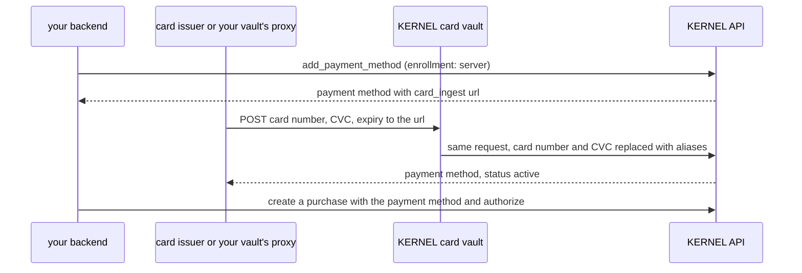

you can add a card to a [KERNEL wallet](/integrations/wallets/pay-with-multiple-cards) from a backend instead of having the cardholder type it in. you start a server enrollment, KERNEL returns a single-use `card_ingest` url, and the card is posted to that url.

the `card_ingest` url is served by KERNEL's PCI-compliant card vault, not by KERNEL's API. the card vault replaces the card number and CVC with aliases before the request reaches KERNEL, so KERNEL never handles raw card data. the agent's browser only ever sees aliases, which are swapped for the real values on the way to the merchant.

the request carries the raw card number and CVC, so it must come from an environment that's allowed to handle them. there are two common ways to send it:

- **from a card issuer.** a bank, card program, or payment provider creates a single-use card for one checkout and posts it from its own PCI-compliant backend. use this for virtual cards issued per purchase.
- **from your own card vault.** your cards already live in a third-party vault, such as VGS, Basis Theory, Skyflow, or Evervault. your backend sends the request with your vault's aliases through the vault's outbound proxy, which swaps in the real values on the way out. the raw card only exists between the two vaults, so your servers never handle it. see [push from your own card vault](#push-from-your-own-card-vault).

for a card the cardholder enters themselves, use [hosted enrollment](/integrations/wallets/pay-with-multiple-cards#add-a-card) instead. if your cards are in your own VGS vault, you can also [let KERNEL read them from your vault](/integrations/wallets/bring-your-own-vgs-vault) instead of pushing each card.

<Warning>
never post raw card data from servers that aren't allowed to handle it. if your backend isn't PCI-compliant, send the card through a card vault's proxy, as described below.
</Warning>

<Note>
server enrollment is enabled per organization. `add_payment_method` with `enrollment: "server"` returns `409` until it's configured for your organization. [contact support](/info/support) to enable it.
</Note>

## How it works



## Start a server enrollment

invoke `add_payment_method` on a connected KERNEL wallet with `enrollment: "server"`. the result is a payment method in `pending_enrollment` whose `action` is a `card_ingest` url that expires 5 minutes later. each call creates a separate url for one card.

<CodeGroup>

```typescript TypeScript
import Kernel from "@onkernel/sdk";

const kernel = new Kernel({
  projectID: process.env.KERNEL_PROJECT_ID!,
  maxRetries: 0,
});
const vault = await kernel.vaults.upsert({ name: "user-12345" });

const added = await kernel.vaults.items.performOperation("card-wallet", {
  id_or_name: vault.id,
  type: "add_payment_method",
  enrollment: "server",
});
if (added.type !== "add_payment_method") {
  throw new Error("unexpected operation response");
}

const paymentMethod = added.payment_method;
// send paymentMethod.action.url to whoever posts the card; don't log it or give it to the agent
console.log(paymentMethod.id, paymentMethod.action?.name, paymentMethod.expires_at);
```

```python Python
import os

from kernel import Kernel

kernel = Kernel(project_id=os.environ["KERNEL_PROJECT_ID"], max_retries=0)
vault = kernel.vaults.upsert(name="user-12345")

added = kernel.vaults.items.perform_operation(
    "card-wallet",
    id_or_name=vault.id,
    type="add_payment_method",
    enrollment="server",
)
if added.type != "add_payment_method":
    raise RuntimeError("unexpected operation response")

payment_method = added.payment_method
# send payment_method.action.url to whoever posts the card; don't log it or give it to the agent
print(payment_method.id, payment_method.action.name, payment_method.expires_at)
```

</CodeGroup>

start the enrollment only when the card is ready to be pushed. the url can't be renewed: if it expires, start another enrollment. an expired or unused enrollment doesn't affect the wallet's other cards.

## Push the card

post the card as JSON to the exact `card_ingest` url, with a KERNEL API key in the `Authorization` header. the key must belong to the wallet's organization and have `vaults:use` and `vaults:write` on the vault. if the wallet isn't in your organization's default project, send the same `X-Kernel-Project` header you used to start the enrollment.

| field | required | value |
| --- | --- | --- |
| `card.number` | yes | card number, 13 to 19 digits, as a string |
| `card.cvc` | yes | 3 or 4 digits, as a string |
| `card.exp_month` | yes | two digits, `"01"` to `"12"` |
| `card.exp_year` | yes | four digits, such as `"2029"` |
| `network` | yes | `visa`, `mastercard`, `amex`, `discover`, `jcb`, `diners`, or `unionpay`. it must match the card number |
| `last4` | yes | the card number's last four digits |
| `valid_until` | yes | RFC 3339 timestamp in the future. KERNEL stops using the card at this time |
| `issuer_reference` | no | your own id for the card, up to 128 letters, digits, `.`, `_`, `:`, or `-`. it's returned on the payment method so you can match it to your records |

send every card value as a string, and send no other fields. the body must be `application/json` and under 8 KB.

### From a card issuer

the issuer posts the card directly from its PCI-compliant backend:

<CodeGroup>

```typescript TypeScript
const response = await fetch(cardIngestUrl, {
  method: "POST",
  headers: {
    Authorization: `Bearer ${process.env.KERNEL_API_KEY}`,
    "Content-Type": "application/json",
  },
  body: JSON.stringify({
    card: {
      number: "4111111111111111",
      cvc: "123",
      exp_month: "09",
      exp_year: "2029",
    },
    network: "visa",
    last4: "1111",
    issuer_reference: "vcard_7781",
    valid_until: new Date(Date.now() + 2 * 60 * 60 * 1000).toISOString(),
  }),
});
if (!response.ok) {
  const error = await response.json();
  throw new Error(`card push failed: ${response.status} ${error.code}`);
}
const { payment_method } = await response.json();
console.log(payment_method.id, payment_method.status);
```

```python Python
import os
from datetime import datetime, timedelta, timezone

import requests

response = requests.post(
    card_ingest_url,
    headers={"Authorization": f"Bearer {os.environ['KERNEL_API_KEY']}"},
    json={
        "card": {
            "number": "4111111111111111",
            "cvc": "123",
            "exp_month": "09",
            "exp_year": "2029",
        },
        "network": "visa",
        "last4": "1111",
        "issuer_reference": "vcard_7781",
        "valid_until": (datetime.now(timezone.utc) + timedelta(hours=2)).isoformat(),
    },
    timeout=30,
)
if not response.ok:
    raise RuntimeError(f"card push failed: {response.status_code} {response.json()['code']}")
payment_method = response.json()["payment_method"]
print(payment_method["id"], payment_method["status"])
```

</CodeGroup>

### Push from your own card vault

if your cards are in a third-party vault, send the same request from your backend with your vault's aliases in `card.number` and `card.cvc`, routed through your vault's outbound proxy. configure the proxy to reveal those two fields on requests to the `card_ingest` url's host, so the real values only exist between your vault and KERNEL's card vault. the exact setup depends on your vault; see its outbound proxy or reveal documentation.

your vault needs a CVC for the card. most vaults don't keep a CVC for stored cards, so collect it again, or keep it only for the short time your vault allows, before each push.

<CodeGroup>

```typescript TypeScript
import { fetch, ProxyAgent } from "undici";

// your vault's outbound proxy, configured to reveal $.card.number and $.card.cvc
const vaultProxy = new ProxyAgent({
  uri: process.env.VAULT_OUTBOUND_PROXY_URL!,
  requestTls: { ca: process.env.VAULT_OUTBOUND_PROXY_CA },
});

const response = await fetch(cardIngestUrl, {
  method: "POST",
  dispatcher: vaultProxy,
  headers: {
    Authorization: `Bearer ${process.env.KERNEL_API_KEY}`,
    "Content-Type": "application/json",
  },
  body: JSON.stringify({
    card: {
      number: "tok_live_5UpnbMvaihRuRwz5QXwBFw",
      cvc: "tok_live_9rKpQ2sLmN4vXw8yZt1aBc",
      exp_month: "09",
      exp_year: "2029",
    },
    network: "visa",
    last4: "1111",
    issuer_reference: "card_on_file_2291",
    valid_until: new Date(Date.now() + 2 * 60 * 60 * 1000).toISOString(),
  }),
});
```

```python Python
import os
from datetime import datetime, timedelta, timezone

import requests

# your vault's outbound proxy, configured to reveal $.card.number and $.card.cvc
vault_proxy = os.environ["VAULT_OUTBOUND_PROXY_URL"]

response = requests.post(
    card_ingest_url,
    headers={"Authorization": f"Bearer {os.environ['KERNEL_API_KEY']}"},
    json={
        "card": {
            "number": "tok_live_5UpnbMvaihRuRwz5QXwBFw",
            "cvc": "tok_live_9rKpQ2sLmN4vXw8yZt1aBc",
            "exp_month": "09",
            "exp_year": "2029",
        },
        "network": "visa",
        "last4": "1111",
        "issuer_reference": "card_on_file_2291",
        "valid_until": (datetime.now(timezone.utc) + timedelta(hours=2)).isoformat(),
    },
    proxies={"https": vault_proxy},
    verify=os.environ["VAULT_OUTBOUND_PROXY_CA_FILE"],
    timeout=30,
)
```

</CodeGroup>

if the proxy doesn't reveal the aliases, KERNEL's card vault receives your aliases instead of a card. the push then fails with `422`, or stores an unusable card that fails at checkout, so test the setup with a test card first.

### Response

a successful push returns `200` with the payment method, now `active`:

```json
{
  "payment_method": {
    "id": "q4w8z2mkc7tnv1xr9pej5ha3",
    "type": "card",
    "provider": "kernel",
    "status": "active",
    "is_default": false,
    "display": { "brand": "visa", "last4": "1111" },
    "issuer_reference": "vcard_7781",
    "valid_until": "2026-11-09T16:14:52Z",
    "capabilities": { "single_use_card": { "eligible": true, "reasons": [] } }
  }
}
```

### Errors

errors return JSON with a `code` and a `message`. KERNEL never logs the request body or card values.

| status | `code` | meaning |
| --- | --- | --- |
| `401` | `unauthorized` | the API key is missing or invalid |
| `403` | `forbidden` | the request didn't come through the `card_ingest` url, or the key lacks `vaults:use` and `vaults:write` on the vault |
| `404` | `enrollment_not_found` | the url is unknown, expired, or belongs to another organization |
| `409` | `enrollment_used` | the url already enrolled a different card, or its card's CVC was already used or expired. start a new enrollment |
| `409` | `conflict` | the wallet can't take the card right now, such as while it's being removed |
| `422` | `invalid_card` | the body isn't valid JSON, has unknown or invalid fields, has a `valid_until` in the past, or exceeds 8 KB. fix the request and push again to the same url |
| `500` | `internal_error` | the card couldn't be stored. retry the same request |

### Retries

if you lose the response, retry the same request to the same url. a retry with the same card, `network`, `last4`, `issuer_reference`, and `valid_until` returns `200` with the same payment method, so you can tell the card was stored. a different card on a used url returns `409`.

once the card's CVC has been used by a purchase or has expired, a retry returns `409` `enrollment_used`. to push the card again, start a new server enrollment.

## Pay with the pushed card

create a purchase with the pushed card's `id` as `spec.payment_method_id`, as in [choose a card for a purchase](/integrations/wallets/pay-with-multiple-cards#choose-a-card-for-a-purchase). because the CVC came with the card, `authorize` makes the purchase `ready` right away, with no cardholder approval page. the agent then [fills](/vaults/fill) the checkout as usual.

<CodeGroup>

```typescript TypeScript
const purchase = await kernel.vaults.items.upsert("notebook-order", {
  id_or_name: vault.id,
  type: "card",
  spec: {
    provider: "kernel",
    wallet: "card-wallet",
    payment_method_id: paymentMethod.id,
    amount: 2306,
    currency: "usd",
    merchant_name: "example shop",
    merchant_url: "https://shop.example.com/checkout",
  },
});

const authorized = await kernel.vaults.items.performOperation(purchase.key, {
  id_or_name: vault.id,
  type: "authorize",
});
// authorized.state.status is "ready"; fill the checkout now
```

```python Python
purchase = kernel.vaults.items.upsert(
    "notebook-order",
    id_or_name=vault.id,
    type="card",
    spec={
        "provider": "kernel",
        "wallet": "card-wallet",
        "payment_method_id": payment_method.id,
        "amount": 2306,
        "currency": "usd",
        "merchant_name": "example shop",
        "merchant_url": "https://shop.example.com/checkout",
    },
)

authorized = kernel.vaults.items.perform_operation(
    purchase.key,
    id_or_name=vault.id,
    type="authorize",
)
# authorized.state.status is "ready"; fill the checkout now
```

</CodeGroup>

a pushed card pays for exactly one purchase:

- **one purchase per push.** the first purchase to authorize takes the CVC. other purchases on the same card show `funding_status: "unavailable"` and no `authorize` operation, and authorizing them returns `409`. if the first purchase fails before it's issued, the CVC goes back to the card for another purchase.
- **the CVC window starts at the push.** the CVC stays usable for 5 minutes by default, or up to an hour depending on your organization's card vault, and never past `valid_until`. the push, `authorize`, and fill must all happen inside that window, so push the card when the checkout is ready to run. the purchase expires when the CVC does.
- **after the purchase.** the card stays in the wallet as `active` but lists as ineligible with the reason `cvc_unavailable`, or `valid_until_passed` after `valid_until`. remove it with `remove_payment_method`, and push the card again for the next checkout.

## Limit what a pushed card can pay for

KERNEL doesn't bind a pushed card to a merchant or an amount, and there's no cardholder approval step. any API key with `vaults:use` on the vault can spend the card while its CVC is valid.

- **issuer cards:** issue single-use cards that only work at the intended merchant, for the intended amount, and only until `valid_until`.
- **cards from your own vault:** these are usually regular cards with no such limits, so push a card only when its checkout is about to run, set a short `valid_until`, and restrict which API keys have `vaults:use` on the vault.

the same card can be pushed into more than one wallet, including wallets in different organizations. you decide which wallets a card belongs in.
